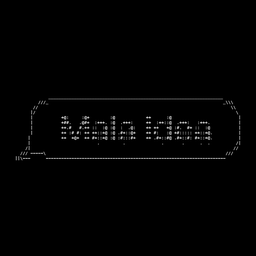
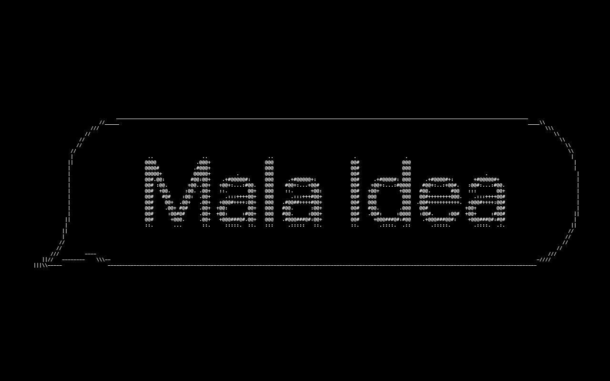
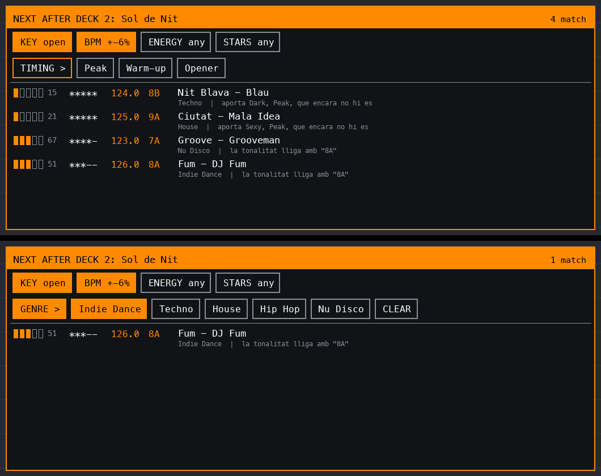

<div align="center">



**Mods de la comunitat AZ-MODS per a l'XDJ-AZ de Mala Idea**

</div>

Mods per a l'[AZ-MODS](https://github.com/Kyle-Hosman/xdj-az-mods) de l'XDJ-AZ, fets amb
l'[AZ-MODS SDK](https://github.com/Kyle-Hosman/az-mods-sdk). Cal tenir el deck amb el
firmware d'AZ-MODS (2.01, core 1.2.3 o més nou).

| Mod | Què fa |
|:--|:--|
| [**Mala Idea Wallpaper**](mala-idea-wallpaper) | Pantalla de repòs: el logo de Mala Idea en ASCII sobre negre |
| [**Deck Suggestions**](deck-suggest) | Carregues un tema i surten els 5 millors per posar després, triats per Backspins des de l'ordinador |

<p align="center"></p>

## Mala Idea Wallpaper

Quan el deck queda quiet (cap toc a la pantalla, cap gir del browse, cap deck sonant), el
logo de Mala Idea tapa tota la pantalla: la bombolla i les lletres resseguides en ASCII
blanc sobre negre, a partir del logo original (`tools/mala-idea-logo.png`).

En tocar la pantalla, girar el browse, carregar o posar en marxa un tema, el deck torna.
El toc que treu el fons no arriba al deck, així que no prem res del que hi havia a sota.

Al **Mod Menu** surt la fila *Mala Idea Wallpaper*: activar-lo o no, **Show after**
(1, 2, 5, 10 o 30 minuts; per defecte 5) i **Show now** per veure'l a l'instant.

> [!NOTE]
> Per què no és un fons *darrere* les ones? AZ-MODS deixa que un mod de la comunitat pinti
> només **per sobre** de la pantalla del deck, mai per sota. Un fons de veritat darrere la
> interfície voldria hooks al dibuix del firmware (adreces que canvien a cada versió), així
> que de moment és una pantalla de repòs.

## Deck Suggestions

Quan un deck carrega un tema (d'un USB o de rekordbox per **Pro DJ Link**), el mod pregunta a
Backspins, a l'ordinador, què hi lliga i mostra un panell amb els 6 millors. Cada fila porta
el **fit** (la barra de cinc i el número, el mateix que a Sets), les teves **estrelles**, BPM,
tonalitat, títol, artista, **gènere** i el perquè. L'ordre és
tonalitat, títol, artista i el perquè. L'ordre és el del model que Backspins aprèn dels teus
sets (què poses després de què).

<p align="center"></p>

Els **filtres** es toquen al panell i la llista es torna a demanar a l'instant:

- **KEY** strict / open / any · **BPM** ±3 / ±6 / ±10 % / any · **ENERGY** any / up / = / down
  (l'energia del comentari) · **STARS** any / 3+ / 4+ / 5.
- **Els teus MyTags i el gènere**: el botó del grup (TIMING, MOOD, TYPE, FAMILY, GENRE) canvia de grup i les
  etiquetes del costat filtren (una per grup, es poden combinar grups). **CLEAR** les treu.
- A dalt a la dreta, quants temes passen els filtres.

Un toc a la capçalera plega el panell en una pestanya **NEXT**; un toc a la pestanya l'obre.
Es plega sol quan fa estona que no el toques. Quan un tema ha sonat 45 segons, el mod
l'apunta a Backspins, i el que punxes al deck també ensenya les suggerències. Res d'això
escriu a rekordbox.

Per fer-lo anar:

1. A Backspins (branca `deck-link` de moment): engega el **Deck link**:
   `python3 decklink.py --on`. Obre un servidor a part al port **47866**, només per a
   aquestes dues preguntes i amb una clau; el servidor de l'app continua només a 127.0.0.1.
2. Connecta a l'ordinador l'USB del deck (el que té la carpeta `MODS`; amb Pro DJ Link
   n'hi ha prou amb un de petit sense música) i escriu-hi l'enllaç:
   `python3 decklink.py --write-stick /Volumes/<USB>`. Desa `BACKSPINS/deck-link.cfg`
   (l'adreça de l'ordinador i la clau).
3. Deck i ordinador a la mateixa xarxa (la de Pro DJ Link ja hi és). Si l'ordinador canvia
   d'adreça, el mod la busca sol per la xarxa.

Al **Mod Menu**: *Deck Suggestions* (on/off), **Panel position** (dalt, mig, baix),
**Keep it open** (10/20/40 s o fins que el toquis), **Link status** (si arriba a Backspins
i per què no) i **Read link file again**.

> [!NOTE]
> Encara no es pot carregar una suggerència des del panell: l'SDK no té cap crida per carregar
> un tema. De moment el busques al navegador del deck.

## Instal·lar-los

Un cop publicat (vegeu *Publicar*), al deck: **Mod Menu > Community Mods > Repositories**,
afegeix `eruizimade/az-mods-malaidea` i instal·la el mod que vulguis. També es pot fer
des de la pestanya *Community Mods* de l'app d'AZ-MODS.

Per provar-lo sense publicar: compila'l i empaqueta'l (a sota) i segueix
[Testing on your deck](https://github.com/Kyle-Hosman/az-mods-sdk/blob/main/docs/04-testing.md).

## Compilar-lo

Cal Docker (amb `linux/arm64`), Python 3 i el SDK al costat:

```sh
git clone https://github.com/Kyle-Hosman/az-mods-sdk ../az-mods-sdk
../az-mods-sdk/tools/azmod-pack build mala-idea-wallpaper     # compila i valida
../az-mods-sdk/tools/azmod-pack package mala-idea-wallpaper   # dist/mala-idea-wallpaper-0.1.0.azmod
../az-mods-sdk/tools/azmod-pack build deck-suggest
../az-mods-sdk/tools/azmod-pack package deck-suggest
```

Les proves de l'SDK (al Mac, amb clang, sense Docker):

```sh
make -C mala-idea-wallpaper test AZ_SDK=$PWD/../az-mods-sdk AZ_SDK_INCLUDE=$PWD/../az-mods-sdk/include
make -C deck-suggest test AZ_SDK=$PWD/../az-mods-sdk AZ_SDK_INCLUDE=$PWD/../az-mods-sdk/include
```

## Canviar el fons

`tools/make_wallpaper.py` ressegueix `tools/mala-idea-logo.png` en ASCII i en fa el fons i l'icona (Pillow + numpy):

```sh
python3 -m pip install pillow numpy
python3 tools/make_wallpaper.py
```

Escriu `images/wallpaper.png` (la vista prèvia), `images/wallpaper-on-deck.png` (com es veurà,
amb 256 colors) i `mala-idea-wallpaper/assets/wallpaper.miw`, el que carrega el mod: un format
mínim (paleta de 256 colors + un byte per píxel) perquè el mod no necessiti cap llibreria
d'imatges.

## Publicar

Puja el repo a GitHub i fes un tag amb la versió de `azmod.json`:

```sh
git tag mala-idea-wallpaper-0.1.0 && git push origin mala-idea-wallpaper-0.1.0
git tag deck-suggest-0.1.0 && git push origin deck-suggest-0.1.0
```

Cada mod té el seu workflow a `.github/workflows/`, que el compila al contenidor de l'SDK, el valida i
penja el `.azmod` i l'icona a la release. Per sortir al Mod Index, PR a
[az-mods-index](https://github.com/Kyle-Hosman/az-mods-index).

## Llicència

GPL-3.0-only, com AZ-MODS i el seu SDK ([`LICENSE`](LICENSE)).

<p align="center"><sub>No afiliat amb AlphaTheta, Pioneer DJ ni rekordbox; les marques són dels seus propietaris.</sub></p>
